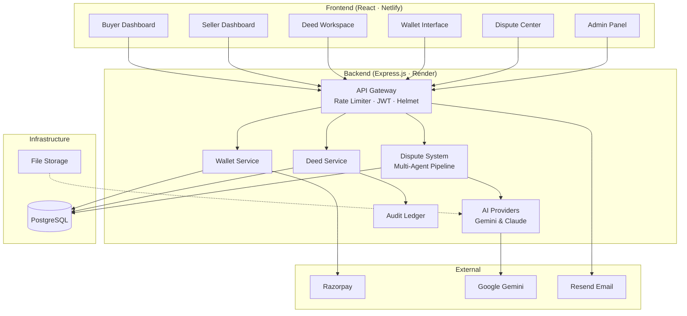
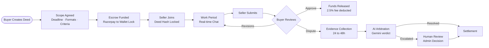

<div align="center">

# ScrowX

### Secure Escrow Infrastructure for the Informal Economy

*Trust through enforceable digital agreements. Scope-first transactions. Evidence-based settlement.*

[](https://nodejs.org)
[](https://react.dev)
[](https://prisma.io)
[](https://aistudio.google.com)
[](https://razorpay.com)

</div>

---

## What is ScrowX?

ScrowX is a secure escrow and payment platform for the gig economy. It lets any two people — a freelancer and a client, a seller and a buyer, or any two parties in a digital deal — transact with the same safety guarantees as a bank-backed escrow, without the bank.

The core mechanism is simple: **money is locked in escrow before work begins, and only released when both parties fulfill their agreed obligations.** If there's a dispute, an AI arbitration engine — powered by Google Gemini — reviews the evidence and issues a verdict.

---

## Why ScrowX Exists

The informal economy — freelancers, gig workers, social media promoters, and peer-to-peer traders — processes billions of transactions annually with no enforcement mechanism.

**Buyers** pay upfront and risk getting nothing. **Sellers** deliver work and risk never being paid. Platforms like Fiverr and Upwork lock you into high fees and opaque dispute processes. Traditional escrow services require legal identity verification and serve enterprise deals only.

ScrowX fills this gap with:

- **Phone KYC only** — no legal identity required to get started
- **2.5% seller-side fee** — zero buyer fee
- **Near-instant wallet settlement** — no bank clearing windows
- **AI arbitration** — automated, evidence-based, and transparent

---

## Core Features

| Feature | Description |
|---|---|
| **🔒 Escrow Payments** | Funds locked in internal wallet escrow before work begins; released atomically on completion |
| **📜 Digital Deeds** | Every transaction anchored to a cryptographically signed scope agreement — the single source of truth |
| **⚙️ Order Orchestration** | Full state machine from Draft → Active → Delivery → Completion with revision and dispute paths |
| **🤖 AI Dispute Resolution** | Three-tier engine: rule scoring → Gemini AI verdict → human escalation for edge cases |
| **💳 Wallet System** | Internal ledger-based wallet with append-only transaction log and double-entry accounting |
| **🔗 Immutable Audit Ledger** | SHA-256 hash-chained log of every action — tamper-evident and independently verifiable |

---

## High-Level Architecture



---

## Core User Flow



---

## Key Components

### 💳 Wallet System

All funds flow through an internal wallet — not direct bank transfers. When a buyer funds a deed, money moves from their `balance` to `lockedBalance`. When work is approved, locked funds are credited to the seller's wallet instantly — no payment gateway round-trip required. Every balance change creates an immutable `WalletTransaction` ledger entry.

> **Design rule:** All monetary values stored in paise (integer). ₹100 = `10000` in the database. No floating point.

### 📜 Deed Engine

The `Deed` is the singular source of truth for every transaction. It captures what will be delivered, in what format, by when, how many revisions are allowed, and for how much — *before* any money moves. When a seller joins via invite link, the core deed fields are SHA-256 hashed and locked. Any subsequent scope dispute references this immutable record.

### ⚙️ Order Orchestration

Every deed runs through a strict state machine managed exclusively by `DeedService`. No component may mutate `deed.status` directly. Every state transition emits an audit ledger event, triggers notifications, and applies the appropriate wallet operation atomically.

```
DRAFT → PENDING_SELLER → ACTIVE → SUBMITTED → CONFIRMED → CLOSED
                                       ↓              ↓
                               CHANGES_REQUESTED   DISPUTED → CLOSED
```

### 🤖 AI Dispute Resolution

Disputes are processed through a 5-stage multi-agent pipeline:

1. **Evidence Extractor (AI)** — Uses Gemini Vision to parse chat screenshots and text to extract neutral, factual bullet points without assigning blame.
2. **Rule Checker (Deterministic)** — A pure math engine that checks hard contractual rules (deadlines, revision limits, late submissions).
3. **Risk Scorer (Heuristic)** — Calculates a 0-100 behavioral risk score based on account age, KYC status, and dispute history.
4. **Context Builder (Combiner)** — Merges the outputs of the previous stages into a unified, structured dispute context.
5. **Verdict Synthesizer (AI)** — The final arbiter. A multi-provider LLM setup (Gemini Flash → Flash Lite → Claude fallback) that issues a verdict (`REFUND_BUYER`, `RELEASE_TO_SELLER`, or `MANUAL_REVIEW_REQUIRED`).

Deals over ₹10,000 (high-stakes) or with low AI confidence are automatically escalated to **Human Review**, where an admin makes the binding final decision using the AI report as advisory context.

---

## Tech Stack

| Layer | Technology |
|---|---|
| **Frontend** | React 19, React Router v7, Vite 7, TailwindCSS, Framer Motion |
| **Backend** | Node.js, Express.js, Socket.IO |
| **Database** | PostgreSQL via Prisma ORM v5 |
| **AI — Disputes** | Google Gemini (`@google/genai`) with Anthropic Claude fallback |
| **AI — Support** | xAI Grok with OpenAI fallback |
| **Payments** | Razorpay (INR) |
| **Email** | Resend |
| **File Analysis** | Tesseract.js (OCR) · Sharp · imghash · file-type |
| **Security** | helmet · express-rate-limit · bcryptjs · jsonwebtoken |
| **Deployment** | Render (backend) · Netlify (frontend) |

---


## Quick Start

```bash
# 1. Clone
git clone <repository_url> && cd Escrow

# 2. Install (postinstall runs prisma generate automatically)
npm install

# 3. Configure environment
copy .env.example .env   # fill in DATABASE_URL, GEMINI_API_KEY, RAZORPAY keys, JWT_SECRET

# 4. Push schema
npx prisma db push

# 5. Run
node server.js      # Backend: http://localhost:3000
npm run dev         # Frontend: http://localhost:5173
```

**Required env vars:** `DATABASE_URL` · `JWT_SECRET` · `RAZORPAY_KEY_ID` · `RAZORPAY_KEY_SECRET` · `GEMINI_API_KEY` · `RESEND_API_KEY` · `VITE_API_URL`

---

## Further Reading

For a complete technical deep-dive — sequence diagrams, database schema, wallet concurrency guards, AI confidence scoring model, scalability architecture — refer to the internal engineering documentation in this repository.

---

<div align="center">
  <sub>Built for the informal economy · 2.5% fee · AI-first arbitration · Deed-anchored trust</sub>
</div>
